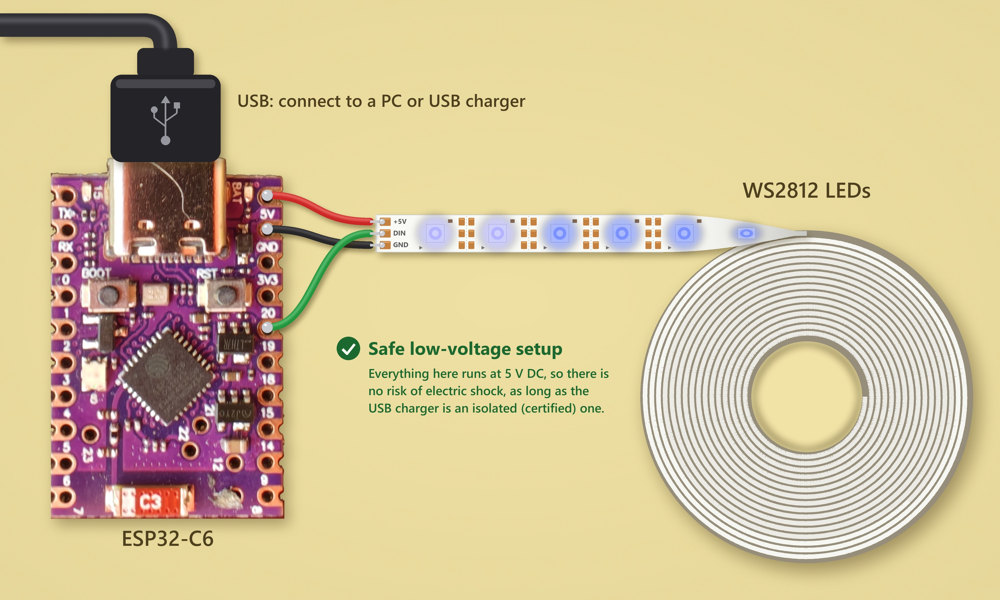
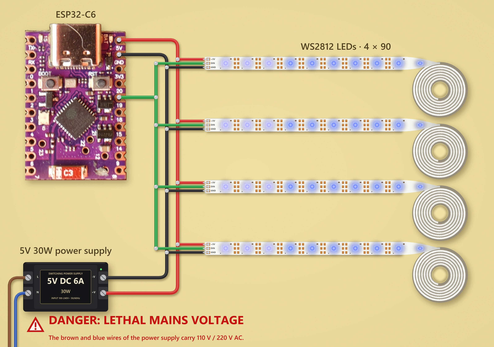
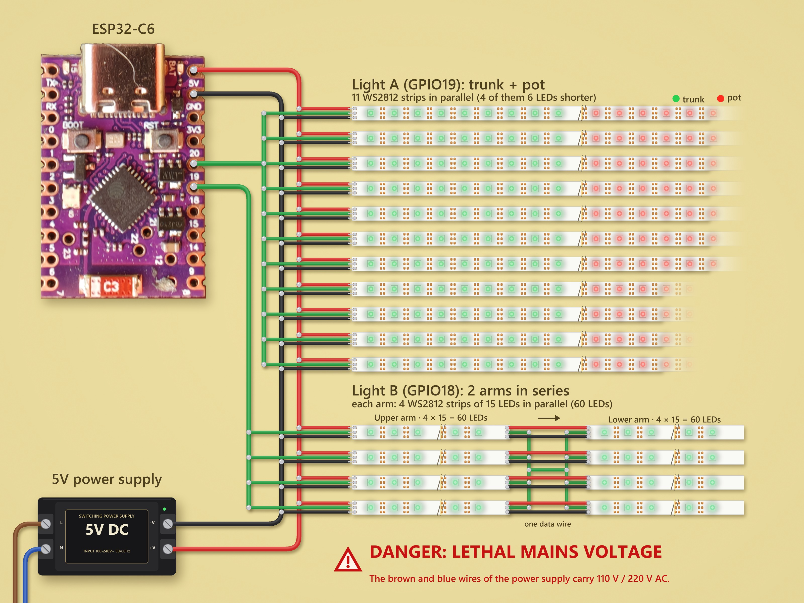

# Open Hue-Native & Ambilight LED Lamps on ESP32-C6

## See it working

| Demo video | Short |
| :---: | :---: |
| <a href="https://youtu.be/Gbain6qyVqY"></a> | <a href="https://youtube.com/shorts/mOq-MSJDjjk"></a> |
| ▶ [Lola, Hue and Ambilight compatible](https://youtu.be/Gbain6qyVqY) | ▶ [Watch the short](https://youtube.com/shorts/mOq-MSJDjjk) |

Two DIY addressable-LED lamps built on the ESP32-C6 that pair directly with a Philips Hue Bridge. The bridge accepts
them as Hue colour lights, so they live in the Hue app next to genuine bulbs: rooms, scenes, routines and Hue
Entertainment, including Ambilight + Hue TVs. No Zigbee2MQTT, deCONZ or extra hub is needed. The repository also
includes a [Zigbee sniffer](#zigbee-sniffer-development-tool) for a third ESP32-C6: the development tool used to work
out how the bridge pairs a light and streams Entertainment colours. It captures every 802.15.4 frame of a channel and,
with the network key, decrypts and decodes it.

## Summary

- **Hue-native pairing.** Add the lamp from the Hue app with "Search for lights". The bridge interviews it like a
  genuine Hue colour bulb and keeps it.
- **Full Hue app control.** On/off, brightness, colour and colour temperature, rooms, scenes and routines.
- **Ambilight and Hue Entertainment.** When a TV or another Entertainment source streams to the bridge, the lamps
  follow the picture in real time, at about 20 updates per second.
- **More than one colour per lamp.** Each lamp is a single light in the Hue app, but the firmware spreads colours over
  the different parts of the lamp: the cactus pot contrasts with the plant, and Lola has five segments.
- **ESPHome firmware.** Built on ESPHome with ESP-IDF and a Zigbee component (`src/components/huewejnorg`) that is a
  modified version of an existing library, see [Origin of the code](#origin-of-the-code). The same firmware can also
  run in Wi-Fi mode with Home Assistant.

| Device | LEDs | Firmware |
| --- | --- | --- |
| Cactus | 707 | `cactus_ambilight.yaml` |
| Lola | 360 | `LolaLampGradientHue.yaml` |
| Zigbee sniffer | None, it is a development tool | `snifferzigbeewifi.yaml` + `zbsniffer.h` |

### How it works

The ESP32-C6 has an 802.15.4 radio, so it joins the Hue Zigbee network directly. The component presents a Hue colour
bulb profile and answers the bridge's manufacturer-specific requests the way a genuine bulb does, so the bridge
accepts the lamp as a Hue light.

During an Entertainment session the bridge sends the colours of every light in the area to one genuine bulb, the
proxy, which rebroadcasts them to all lights. The lamps read that broadcast, take the colours they need and paint
their LEDs. One second after the stream stops, they go back to the colour set in the Hue app.

## Cactus

A cactus-shaped lamp: a trunk with two arms, standing in a pot. It has 707 WS2812 LEDs on two data lines.

| Part | LEDs | Total | Data line |
| --- | --- | --- | --- |
| Trunk | 43 x 11 | 473 | GPIO19 |
| Pot | 19 x 6 | 114 | GPIO19, after the trunk |
| Upper arm | 15 x 4 | 60 | GPIO18 |
| Lower arm | 15 x 4 | 60 | GPIO18, after the upper arm |
| **Total** | | **707** | |

### One Hue light, two colours

In the Hue app the cactus is a single colour light, but the plant and the pot do not show the same colour:

- **The plant** (trunk and both arms) is the Hue light. It shows the colour, colour temperature and brightness chosen
  in the app.
- **The pot** follows automatically with a contrasting colour: blue when the plant's colour is mostly red, and red for
  any other colour. It uses the same brightness and turns off with the light.

So a red scene gives a red cactus in a blue pot, and a green or blue scene gives a coloured cactus in a red pot.

### Ambilight

During an Entertainment session, the plant follows the cactus's own zone of the TV picture and the pot keeps the
contrast rule, using the brightness of the stream. If an effect is started from Home Assistant, it takes over until
the session ends.

### Boot animation and effects

At power-up the cactus "grows" twice: the pot lights up red from the bottom, then the trunk turns green up to the tip.
It ends as a green plant in a red pot, until the first Hue command arrives.

In Wi-Fi mode, Home Assistant can also run lighting effects such as Cactus Create, Lightning Rain, Rain Drops,
Breathing Aurora, Sparkle Twinkle, Fire Rise and Glacial.

## Lola

A floor lamp: a shade on top of a tall cone. It has 360 WS2812 LEDs (90 x 4) on one data line (GPIO19). LED 0 is at the top of
the shade and the last LED is at the floor. A status LED on the board (GPIO8) blinks green while the Wi-Fi window is
connected, stays blue once Lola has joined the Zigbee network, and blinks red while it is still searching.

From the Hue app, Lola is one light and the whole lamp shows the app colour. The segments come into play with
Ambilight.

### Segments

The strip is split into five segments of 18 LEDs, from the top down. The last LED (90) belongs to segment 5.

| Segment | LEDs | Part of the lamp |
| --- | --- | --- |
| 1 | 0–17 | Top of the shade |
| 2 | 18–35 | Bottom of the shade and top of the cone |
| 3 | 36–53 | Upper cone |
| 4 | 54–71 | Middle of the cone |
| 5 | 72–90 | Lower cone, down to the floor |

The Hue bridge sends one colour per light, so Lola alone could only change colour as a whole. But the Entertainment
stream carries the colours of every light in the area, and Lola receives all of them. Each segment can therefore
follow any light of the area:

- The substitutions `amb_seg1` to `amb_seg5` take the Zigbee short address of a light in the area.
- `0x0000` means Lola's own entry, which is the zone of the picture where Lola is placed.
- If the chosen light is missing from the stream, the segment falls back to Lola's own colour.
- To find the addresses, the `hue_ent` log lists every light of the area with its current colour every 10 seconds.

Example installation: Lola stands to the right of the TV. Its shade starts above the top edge of the TV and the cone
reaches the floor, below the TV. The cactus stands below the TV, so its zone is the closest one to the lower part of
Lola.

| Segment | Colour source | Why |
| --- | --- | --- |
| 1–3 | Lola's own entry | These LEDs are at the height of the TV, on its right side. |
| 4–5 | The cactus's entry | These LEDs are below the TV, next to the cactus. |

Two effects paint the segments:

- **Ambilight Gradient** (default) blends smoothly between the centres of the segments.
- **Ambilight Segments** paints each segment as a solid block.

Colours are smoothed between frames so that the lamp does not flicker. In Home Assistant, the five segments are also
available as separate lights for manual control.

### Hue gradient scenes (experimental)

When the bridge recalls a scene that carries a gradient, Lola stores the gradient points and spreads them along the
lamp, from the base to the top, with the "Hue Gradient" effect. This part has not been tested with every scene yet.

### Boot animation

At power-up Lola grows from the floor to the top, one LED every 15 ms. The foot (the 65 lowest LEDs) lights up brown
and the rest yellow. It pauses for one second at the top and runs a second time, then stays on at full brightness
with the same colours. This boot scene is held until 15 seconds after Lola joins the Zigbee network, so the last
state resent by the bridge does not overwrite it; after that, the Hue app or Ambilight takes over. In Home
Assistant, the "Lola Pie Luz" button brings the scene back.

### Colour accuracy

The Hue app sends colours as CIE xy coordinates. Lola converts them to RGB with the gamut of its own LED strip
instead of sRGB, so colours outside sRGB (the Hue pink, for example) keep their hue instead of turning pure magenta,
and pale colours keep their white. The substitutions `lola_prim_r`, `lola_prim_g` and `lola_prim_b` hold the xy of
the three LED primaries, `lola_rgb_gamma` the gamma of the strip, and `lola_white_mix` adds white to every colour as
a fine adjustment by eye.

### Diagnostics

In Wi-Fi mode, Home Assistant shows the free heap, the loop time and the reason for the last reset. The serial log
prints a life sign every 5 seconds, and a hung task ends in a panic with a backtrace instead of a silent freeze.

## Shared features

- **Own Zigbee identity per lamp.** Each lamp has its own IEEE address, set in the YAML. A board that was paired before
  needs a new address and an erased Zigbee storage partition before it can pair again.
- **Wi-Fi window at boot.** For the first 30 seconds after power-up the lamp is on Wi-Fi for OTA updates and Home
  Assistant, then it switches to Zigbee only. Wi-Fi-only and Zigbee-only modes are also available.
- **Controls in Home Assistant.** Switches for Wi-Fi and Zigbee, a "Zigbee Reset - Re-pair" button and a button that
  replays the boot animation.

## How to try it

### Before compiling: fill in the secrets

The firmware reads its passwords and keys from a `secrets.yaml` file, which is not part of the code. The repository
includes a template, [src/secrets.yaml](src/secrets.yaml), with placeholder values. It is already next to the firmware
YAMLs, where ESPHome looks for it.

1. Fill in every value with your own data.
2. Never commit your filled-in `secrets.yaml`.

| Secret | Used by | What to put |
| --- | --- | --- |
| `wifi_ssid` | All three firmwares | Your main Wi-Fi network |
| `wifi_password` | All three firmwares | Its password, at least 8 characters |
| `wifi_ssid_b` | Lola and sniffer | A second network; repeat `wifi_ssid` if you only have one |
| `api_key_cactushue` | Cactus | Your own Home Assistant API key: `openssl rand -base64 32` |
| `mqttbrokerlocal` | Sniffer | IP address or hostname of your MQTT broker |
| `mqttusername` | Sniffer | MQTT user |
| `mqttpassword` | Sniffer | MQTT password |

The sniffer's Zigbee network key is not in `secrets.yaml`: pass it when compiling (`-s nwk_key`) or send it during the
Wi-Fi window, as described in the sniffer section. Then compile and flash, for example:

```text
esphome run src/LolaLampGradientHue.yaml
```

### Wiring

Three wiring examples, from the safest one to the full installations. In all of them the data line is the green
wire, 5 V is red and GND is black.

#### Safe quick test: 5 V from USB



The fastest way to try the firmware: an ESP32-C6 Super Mini powered from a PC or a USB charger, and one WS2812 strip.

- Board 5V to strip +5V (red).
- Board GND to strip GND (black).
- GPIO19 to strip DIN (green).

> [!TIP]
> **Safe low-voltage setup.** Everything here runs at 5 V DC, so there is no risk of electric shock, as long as the
> USB charger is an isolated, certified one.

USB can only supply about 0.5 A from a PC port and up to about 3 A from a charger, while 90 LEDs at full white can
draw up to 5.4 A. Keep the brightness low in this setup.

#### Full installations with a mains power supply

> [!CAUTION]
> **Danger: lethal mains voltage.** The brown and blue wires of the power supply carry 110 V / 220 V AC, which can
> kill. Only wire the mains side if you are qualified to do it, keep the power supply in a closed enclosure, and
> unplug it before touching any wire. Only the red, black and green wires are low voltage (5 V DC).

##### Lola wiring



- Four strips of 90 WS2812 LEDs in parallel on GPIO19. All four receive the same data, so they show the same colours.
- A 5 V 30 W switching power supply feeds the four strips and the board, through its 5V and GND pins.
- 30 W at 5 V is 6 A, and 360 LEDs at full white can draw about 21.6 A. Limit the brightness in the firmware or use a
  bigger power supply.

##### Cactus wiring



- **Light A (GPIO19): trunk and pot.** 11 WS2812 strips in parallel; 4 of them are 6 LEDs shorter.
- **Light B (GPIO18): two arms in series.** Each arm is 4 strips of 15 LEDs in parallel. The data outputs of the four
  upper-arm strips are joined into one wire, which feeds the four inputs of the lower arm.
- The 5 V power supply feeds both lights and the board. About 700 LEDs at full white can draw more than 40 A, so size
  the power supply for the brightness you need, or limit the brightness in the firmware.

## Zigbee sniffer (development tool)

A third ESP32-C6 runs `snifferzigbeewifi.yaml` with `zbsniffer.h`. It is the tool that was used to work out how the
Hue bridge interviews a new light and how the Entertainment stream works. It does not need a Zigbee stack and it never
transmits: it only listens.

- **Captures every frame of a channel.** The 802.15.4 radio runs in promiscuous mode on one channel (11 by default,
  changeable from Home Assistant). Every frame goes to the USB serial log on one line: beacons, MAC commands, ACKs and
  Zigbee data, with RSSI and LQI.
- **Decrypts and decodes.** With the Zigbee network key it decrypts the NWK layer and decodes NWK, APS, ZDO and ZCL:
  descriptors, attribute reads and reports, scenes, manufacturer-specific commands, leaves and more.
- **Highlights events.** Join windows, association requests and responses, device announcements, leaves and ZCL
  errors also appear as `>>>` lines that are easy to filter. Every second it logs the frame rate, decrypted frames,
  MIC failures and dropped frames.
- **Wi-Fi window at boot.** It waits for Wi-Fi (up to 40 seconds) and then stays on Wi-Fi for 30 seconds for OTA
  updates, Home Assistant and MQTT commands: channel, network key, start now or stay on Wi-Fi. Then it frees the
  radio and starts sniffing. Wi-Fi/802.15.4 coexistence is enabled so that Wi-Fi connects reliably.
- **Network key outside the code.** The key is never in the YAML. Pass it at compile time with `-s nwk_key`, or send
  it during the Wi-Fi window with the API action `set_nwk_key` or the MQTT topic `cmd/nwk_key`. It is saved to flash
  and the log only shows a fingerprint. A lamp built with `log_network_key: true` prints the key in its own log when
  it joins the network.

PC tools in `tools/`:

- `serial_log.py` saves the serial log to a file with millisecond timestamps, reconnects on its own and can reset
  the board through a command file.
- `mqtt_cmd.py` publishes the commands during the Wi-Fi window. It reads the broker and its credentials from
  `src/secrets.yaml`.
- `sniffer_channel_scan.py` restarts the sniffer on each channel to find the one where a given network lives.

## Limitations

- A genuine Hue bulb must act as the Entertainment proxy. The lamps can only receive the stream.
- The bridge sends one colour per light, so multi-colour effects reuse the colours of neighbouring lights.
- No Hue firmware updates. Updates go through ESPHome OTA during the Wi-Fi window.

## Origin of the code

The Zigbee component in `src/components/huewejnorg` is not written from scratch. It is a modified version of
[luar123/zigbee_esphome](https://github.com/luar123/zigbee_esphome), an external ESPHome component for Zigbee on the
ESP32-C6 and ESP32-H2, built on Espressif's Zigbee SDK. The Hue pairing fixes come from Michal Jirků's article
"Getting an ESP32-C6 'Hello, world!' lightbulb linked to Hue Bridge" on [wejn.org](https://wejn.org/) and his
repository [wejn/esp32-huello-world](https://github.com/wejn/esp32-huello-world).

### How it was built up

1. **luar123/zigbee_esphome** is the base: the ESPHome integration, endpoints, clusters, attributes and the Zigbee
   time component.
2. **huezigbee** was a first local copy that added colour helpers (CIE xy to RGB) for Hue colour lights.
3. **huewejnorg** is a fork of huezigbee that applies the four fixes from wejn.org. The name comes from "hue" plus
   "wejn.org".
4. **This project** added the Hue emulation (`hue_emu.c`, `hue_emu.h`) and the rest of the Hue support:
   - a Hue colour bulb profile (LCT015) with the ZLL simple descriptor and the manufacturer-specific replies the bridge
     expects during its interview;
   - reception of the Hue Entertainment stream, including the Inter-PAN broadcast from the proxy bulb;
   - Hue gradient scenes;
   - no replies to group or broadcast messages, like genuine bulbs.

### The four wejn.org fixes

1. **Distributed Trust Center key.** Install the Hue distributed key and allow joining distributed networks, because
   the Hue bridge runs a distributed-security network.
2. **app_device_version = 1.** The ESP Zigbee SDK examples use 0, and the bridge caches device data, so the wrong
   value causes problems later.
3. **On/Off cluster attributes.** Add ON_TIME (0x4001) and GLOBAL_SCENE_CONTROL (0x4000), which the bridge uses.
4. **Leave with reset, without rebooting.** When the bridge removes the light, erase the network data and start
   searching for a network again instead of rebooting the board.

## License

MIT. See [LICENSE](LICENSE).

The code taken from luar123/zigbee_esphome and the ideas and code from wejn/esp32-huello-world belong to their
respective authors.

## Disclaimer

This is an independent open-source project. It is not affiliated with, endorsed by, or sponsored by Signify or
Philips. Philips Hue and Ambilight are trademarks of their respective owners.
